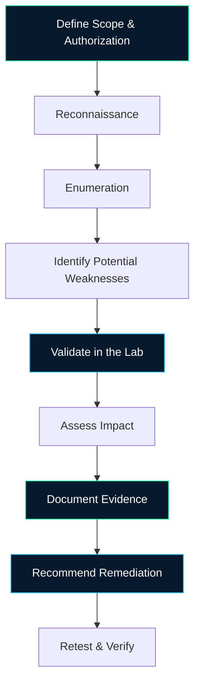

<!--
╔══════════════════════════════════════════════════════════════════╗
║  GITHUB PROFILE README — KRISHNENDU BABU                         ║
║  Theme: Cyberpunk | Neon Green | Electric Blue                   ║
║                                                                  ║
║  IMPORTANT: Replace YOUR_GITHUB_USERNAME with your actual        ║
║  GitHub username everywhere it appears in this file.             ║
╚══════════════════════════════════════════════════════════════════╝
-->

<div align="center">

<!-- HERO BANNER -->


<br/>


<br/>

<a href="https://github.com/YOUR_GITHUB_USERNAME">
  
</a>


<br/><br/>

**Curious about how systems work, how vulnerabilities arise, and how security can be improved.**

*Building practical cybersecurity skills through authorized labs, structured learning, and technical documentation.*

</div>

---

## `$ whoami` — About Me

Hi! I'm **Krishnendu Babu**, an aspiring cybersecurity professional currently developing practical skills in ethical hacking, penetration testing, and vulnerability assessment.

My transition from a life sciences background into cybersecurity reflects my curiosity about technology, systems, and application security. I am learning to identify potential security weaknesses, understand their impact, document findings clearly, and explore appropriate remediation strategies.

I value hands-on practice, continuous learning, and responsible security testing.

```text
┌────────────────────────────────────────────────────────┐
│  USER        : Krishnendu Babu                         │
│  DOMAIN      : Cybersecurity                           │
│  CAREER LEVEL: Entry-level / Internship                │
│  FOCUS       : Web Application Security                 │
│  SPECIALTY   : Penetration Testing & VAPT               │
│  ENVIRONMENT : Kali Linux & Security Labs              │
│  APPROACH    : Learn → Test → Validate → Document       │
└────────────────────────────────────────────────────────┘
```

### 🎯 Career Objectives

- Develop practical skills in web application penetration testing.
- Strengthen my understanding of network reconnaissance and vulnerability assessment.
- Learn Active Directory security testing and identity-related attack paths.
- Produce clear, evidence-based security reports with remediation recommendations.
- Contribute to cybersecurity projects and gain experience in a professional security team.

### 🤝 Opportunities I'm Interested In

- Cybersecurity Internships
- Junior Penetration Tester
- Entry-Level VAPT Analyst
- Web Application Security Intern
- Junior Security Testing Roles

---

## 🧰 Technical Skills & Tools

*These categories represent my current learning and hands-on practice, not claims of expert-level proficiency.*

### 💻 Operating Systems

<p>
  
  
</p>

- Using Kali Linux for authorized cybersecurity labs.
- Navigating Linux directories and working with terminal commands.
- Running and interpreting security tools in a lab environment.

### 🔎 Network Reconnaissance & Traffic Analysis

<p>
  
  
</p>

- Network and port scanning using Nmap.
- Identifying discovered services and reviewing scan results.
- Exploring packet captures and network traffic using Wireshark.

### 🌐 Web Application Security

<p>
  
  
  
</p>

- Exploring HTTP requests and responses using Burp Suite.
- Performing WordPress security enumeration using WPScan.
- Practising web application security testing in authorized environments.
- Studying OWASP Top 10 concepts and common vulnerability classes.
- Learning to validate security findings and assess potential impact.

### 🏴‍☠️ Exploitation & Active Directory Security

<p>
  
  
  
</p>

- Exploring exploitation workflows in authorized lab environments.
- Learning Active Directory enumeration and attack-path analysis.
- Using BloodHound to explore relationships and potential privilege paths.
- Studying authentication, authorization, and access-control weaknesses.

### 📋 Vulnerability Assessment & Documentation

<p>
  
  
</p>

- Recording observations and supporting evidence.
- Organizing findings into understandable vulnerability reports.
- Describing potential impact and recommending remediation.
- Practising responsible disclosure principles and authorized testing.

---

## 🚀 Featured Projects & Security Labs

*These projects reflect my learning and lab work. Findings should be published only after validation, with sensitive details and private lab information removed.*

### 01 — Web Application Security Assessment

<p>
  
  
  
</p>

**Target:** `blog.offenso.local` — private training lab

**Objective:** Explore the security of a WordPress-based web application and learn a structured approach to web vulnerability assessment.

**Areas of investigation**
- Application and technology fingerprinting.
- HTTP request and response analysis.
- WordPress security enumeration.
- Review of authentication, authorization, and access-control behavior.
- Investigation of potential web vulnerability classes.
- Documentation of evidence, impact, and remediation recommendations.

**Tools:** Burp Suite, WPScan, Nmap, Kali Linux.

**Learning outcome:** Practise a repeatable testing methodology and organize observations into a professional security assessment.

**Repository:** [Add your public project repository here](https://github.com/YOUR_GITHUB_USERNAME)

> The hostname above belongs to a training environment. It is not presented as a publicly accessible website or as evidence of a confirmed vulnerability.

---

### 02 — OWASP Top 10 Practice

<p>
  
  
</p>

**Objective:** Build an understanding of common web application security risks and practise identifying them in intentionally vulnerable or authorized applications.

**Areas of study**
- Broken access control.
- Injection vulnerabilities.
- Authentication and session-management weaknesses.
- Security misconfiguration.
- Identification and analysis of other relevant OWASP risk categories.

**Approach**
1. Understand the vulnerability and its security implications.
2. Identify suitable test cases in an authorized environment.
3. Collect reproducible evidence.
4. Evaluate the potential impact.
5. Document practical remediation guidance.

**Tools:** Burp Suite, Kali Linux, Nmap.

**Repository:** [Add your OWASP practice repository here](https://github.com/YOUR_GITHUB_USERNAME)

*Only vulnerabilities actually reproduced and verified should be listed as confirmed findings.*

---

### 03 — crAPI Security Testing Lab

<p>
  
  
</p>

**Objective:** Learn API security testing using crAPI, an intentionally vulnerable application designed for security education.

**Areas of exploration**
- Understanding API endpoints and request structures.
- Inspecting HTTP requests and responses.
- Learning authentication and authorization testing concepts.
- Studying potential API access-control weaknesses.
- Recording test cases, evidence, and remediation ideas.

**Tools:** Burp Suite, Kali Linux, browser developer tools where applicable.

**Repository:** [Add your crAPI lab notes here](https://github.com/YOUR_GITHUB_USERNAME)

**Learning outcome:** Improve my understanding of API behavior and the relationship between web application security and API security.

---

## 🧪 My Security Testing Workflow



My goal is to follow a structured, evidence-driven process rather than rely solely on automated tool output.

---

## 📊 GitHub Analytics

*Live statistics below depend on GitHub's public data and third-party widget availability. They are not manually estimated achievements.*

<div align="center">

### Profile Overview


### Contribution Activity


### Contribution Streak


</div>

> **Analytics note:** Language charts show languages detected in your repositories, not your overall technical proficiency. Activity graphs reflect recorded GitHub contributions. Third-party widgets may have outages, caching delays, or display limitations.

---

## 🎓 Education & Training

### Bachelor of Science — Botany

**Mahatma Gandhi University, Kerala**  
2023–2026

My academic background in life sciences has helped develop my interest in research, structured investigation, and evidence-based analysis. I am applying that learning mindset to cybersecurity.

### Cybersecurity & Ethical Hacking Training

**Offenso Hackers Academy**  
2026 — In Progress

Current learning areas include ethical hacking, penetration-testing tools, web application security, vulnerability assessment, and security documentation.

**Career focus:** Penetration Testing | Vulnerability Assessment (VAPT) | Web Application Security

---

## 📚 Current Learning Roadmap

| Area | Learning objective |
|---|---|
| Web security | Improve vulnerability identification and validation |
| API security | Understand endpoint behavior and authorization testing |
| Network security | Strengthen scanning and service enumeration skills |
| Active Directory | Develop identity-security testing fundamentals |
| Reporting | Produce clear, reproducible security findings |
| Portfolio | Publish sanitized lab reports and supporting documentation |
| Professional growth | Prepare for cybersecurity internships and entry-level roles |

This roadmap represents ongoing learning goals, not a claim that every topic has been mastered.

---

## 🛡️ Responsible Security Principles

I believe cybersecurity work should be practical, ethical, and evidence-based.

- Test only systems for which I have explicit authorization.
- Respect privacy and protect sensitive information.
- Validate findings before describing them as vulnerabilities.
- Avoid publishing credentials, private addresses, tokens, or sensitive lab data.
- Provide remediation recommendations alongside security findings.
- Continue learning from feedback, documentation, and hands-on practice.

---

## 🌐 Connect With Me

<div align="center">

<a href="https://github.com/YOUR_GITHUB_USERNAME">
  
</a>

<a href="mailto:krishnendubabu477@gmail.com">
  
</a>

<br/><br/>

**Interested in cybersecurity internships, collaborative learning, and entry-level opportunities.**

*Let's learn, investigate, document, and build more secure systems.*

<br/>


</div>

<!-- END OF PROFILE README -->
